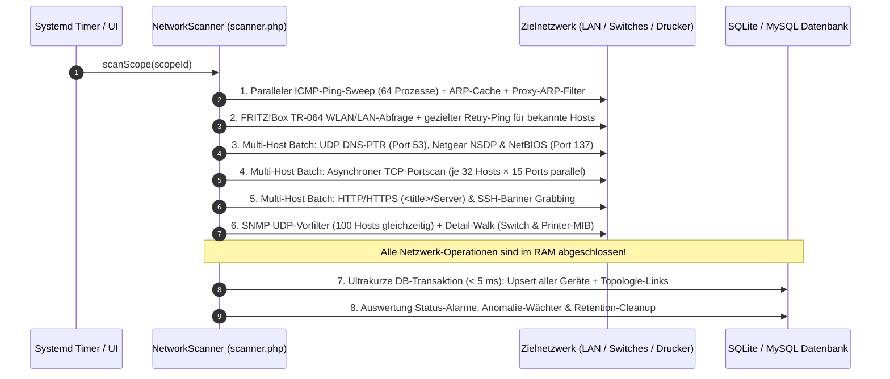
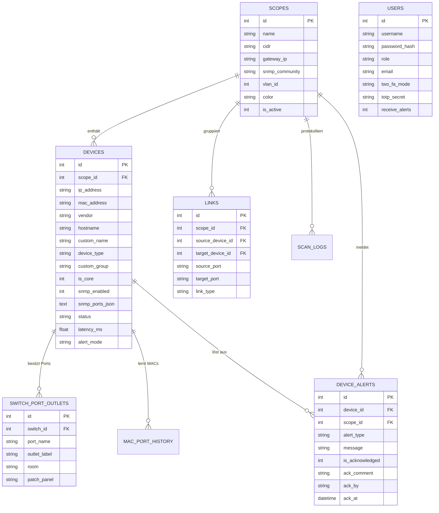

# 📘 Anwendungskonzept (Fach-, Architektur- & Betriebskonzept): NetworkMonitor (`v1.12.8`)

**Systembezeichnung:** NetworkMonitor – Automatischer Netzwerkplan, SNMP-Switch-Discovery & Anomalie-Wächter  
**Dokumententyp:** Anwendungs-, Facharchitektur- und Betriebskonzept  
**Software-Version:** `v1.12.8`  
**Zielgruppe:** IT-Leitung, Netzwerkadministratoren, Systembetrieb & Entwickler  

---

## 1. Ausgangslage & Zielsetzung der Anwendung

In gewachsenen Unternehmens-, Behörden- und anspruchsvollen Heimnetzwerken fehlt häufig eine tagesaktuelle, verlässliche Dokumentation darüber:
- **welche aktiven Geräte** sich in welchen IP-Subnetzen/VLANs befinden,
- **an welchem konkreten Switch-Port und welcher Wand-/Netzwerkdose** ein Endgerät (PC, Drucker, Access Point, Telefon, Kamera) angeschlossen ist,
- **wie Switches untereinander kaskadiert oder gestackt** sind (Core-, Distribution- und Access-Ebene),
- **wann kritische Systeme ausfallen** oder **sicherheitsrelevante Netzwerk-Anomalien** (ARP-Spoofing, fremde Mini-Switches an Bürodosen, MAC-Flapping/Schleifen) auftreten.

**NetworkMonitor** löst diese Aufgabe als leichtgewichtige, eigenständige Web-Appliance **ohne externe Abhängigkeiten** (kein separates Nmap, kein Java, kein Node.js, keine Cloud-Anbindung erforderlich). Alle Netzwerk-, SNMP-, DNS-, NetBIOS- und Banner-Abfragen sind direkt in hochoptimiertem PHP mit parallelen Non-Blocking-Sockets implementiert.

---

## 2. System- & Software-Architektur

### 2.1 Schichtenarchitektur (3-Tier-Modell)

```mermaid
flowchart LR
    subgraph Frontend["1. Präsentationsschicht (SPA-Frontend)"]
        UI_Top["🗺️ Topologie-Karte\n(vis.js / Hierarchie / Matrix / 19\"-Rack)"]
        UI_SW["🎛️ Grafische 19\"-Switch-Blende\n(Live Port-Status, PoE, Dose, Kaskade)"]
        UI_Inv["📋 Geräte-Inventarliste\n(Excel-Filter, Gruppierung, CSV-Export)"]
        UI_Mac["🔍 MAC-, Dosen- & Port-Finder\n(Echtzeit-Suche über alle Switches)"]
        UI_Adm["⚙️ Administration & Alarm-Center\n(RBAC, Anomalie-Wächter, GitHub-Updater)"]
    end

    subgraph Backend["2. Applikations- & Fachlogikschicht (PHP)"]
        Router["🛡️ router.php\n(Security-Whitelist & Header)"]
        API["🔌 api.php\n(REST-JSON Controller)"]
        Auth["🔐 includes/auth.php\n(Session, RBAC, TOTP/E-Mail 2FA)"]
        Scanner["📡 includes/scanner.php\n(Parallele 7-Phasen Scan-Engine)"]
        SNMP["🖧 includes/snmp_client.php\n(Nativer ASN.1/BER SNMP v2c Client)"]
        OUI["🏷️ includes/oui.php\n(IEEE MAC-Vendor & Auto-Klassifizierung)"]
        Mail["✉️ includes/mailer.php\n(STARTTLS/SSL SMTP-Client)"]
    end

    subgraph Data["3. Datenhaltungsschicht (PDO)"]
        DB_Class["🗄️ includes/db.php\n(Auto-Schema-Migration v1128)"]
        SQLite[("SQLite 3 (WAL-Modus)\nnetwork_monitor.sqlite")]
        MySQL[("Optional: MySQL / MariaDB\n(für Großinstallationen)")]
    end

    Frontend <-->|"JSON via Fetch API"| Router
    Router --> API
    API --> Auth
    API --> Scanner
    API --> Mail
    Scanner --> SNMP
    Scanner --> OUI
    Scanner --> DB_Class
    API --> DB_Class
    DB_Class --> SQLite
    DB_Class -.-> MySQL
```

### 2.2 Verzeichnis- und Modulstruktur

| Datei / Pfad | Fachliche Verantwortung |
| :--- | :--- |
| [`index.php`](file:///home/uwe/Dokumente/Antigravity/NetworkMonitor/index.php) | Hauptanwendungs-Shell (Topbar, 4 Hauptreiter, Modals für 19"-Switch-Ansicht, SNMP-Inspektor, Alarm-Zentrale, MAC-/Dosen-Finder). |
| [`login.php`](file:///home/uwe/Dokumente/Antigravity/NetworkMonitor/login.php) | Anmeldemaske inkl. 2FA-Dialog (Authenticator-App TOTP & E-Mail-Code) sowie Selbstbedienungs-Passwort-Reset. |
| [`hilfe.php`](file:///home/uwe/Dokumente/Antigravity/NetworkMonitor/hilfe.php) | Integriertes deutschsprachiges Benutzer- und Administrationshandbuch. |
| [`router.php`](file:///home/uwe/Dokumente/Antigravity/NetworkMonitor/router.php) | Sicherheits-Router für den eingebauten PHP-Server (`php -S`), blockiert unbefugte Dateizugriffe (`403 Forbidden`). |
| [`api.php`](file:///home/uwe/Dokumente/Antigravity/NetworkMonitor/api.php) | Zentraler JSON-API-Controller für alle Frontend-Aktionen (Topologie-Abruf, Scan, Switch-Port-Steuerung, Alarme, Admin-Konfiguration). |
| [`cli_scan.php`](file:///home/uwe/Dokumente/Antigravity/NetworkMonitor/cli_scan.php) | Kommandozeilen-Scanner für den Hintergrundbetrieb per Systemd-Timer (`network-monitor-scan.timer`) oder Cronjob. |
| [`includes/scanner.php`](file:///home/uwe/Dokumente/Antigravity/NetworkMonitor/includes/scanner.php) | Parallele Multi-Host-Scan-Engine, Layer-2/Layer-3-Topologie-Berechnung, Switch-Port-Konfigurator (SSH/Telnet/SNMP) und Anomalie-Wächter. |
| [`includes/snmp_client.php`](file:///home/uwe/Dokumente/Antigravity/NetworkMonitor/includes/snmp_client.php) | Reiner PHP ASN.1/BER SNMPv2c-Client (`GetRequest`, `GetNextRequest`, `GetBulkRequest`, `SetRequest`) mit persistentem UDP-Socket und `request-id`-Validierung. |
| [`includes/oui.php`](file:///home/uwe/Dokumente/Antigravity/NetworkMonitor/includes/oui.php) | Offline-Herstellerdatenbank (IEEE OUI MAC-Präfixe) und heuristische Geräteklassifizierung (`router`, `switch`, `ap`, `printer`, `server`, `workstation`). |
| [`includes/db.php`](file:///home/uwe/Dokumente/Antigravity/NetworkMonitor/includes/db.php) | Datenbank-Abstraktionsschicht (SQLite WAL & MySQL/MariaDB) inkl. automatischer Schema-Migration (`PRAGMA user_version`). |
| [`includes/auth.php`](file:///home/uwe/Dokumente/Antigravity/NetworkMonitor/includes/auth.php) | Sitzungsverwaltung, RBAC-Prüfung, TOTP/E-Mail-2FA und IP-/Session-Brute-Force-Schutz. |
| [`assets/app.js`](file:///home/uwe/Dokumente/Antigravity/NetworkMonitor/assets/app.js) | Gesamte Client-Logik: `vis.js`-Topologie-Renderer, 19"-Switch-Grafik, Excel-Tabellenfilter, Internationalisierung (`de`/`en`) und Theme-Engine. |

---

## 3. Fachliche Kernfunktionen im Detail

### 3.1 Mehrstufige Hochgeschwindigkeits-Scan-Engine (~11 – 14 s pro `/24`-Netz)
Um ein komplettes `/24`-Subnetz (254 IP-Adressen) inklusive Managed Switches und Netzwerkdruckern in wenigen Sekunden ohne Datenbank-Blockaden zu scannen, arbeitet [`NetworkScanner::scanScope()`](file:///home/uwe/Dokumente/Antigravity/NetworkMonitor/includes/scanner.php#L47-L460) in **8 aufeinander abgestimmten Phasen**:



1. **Parallele Host-Discovery & Proxy-ARP-Erkennung:**
   - Bis zu 64 parallele Ping-Prozesse ermitteln aktive Hosts und deren Antwortzeit (`latency_ms`) sowie TTL.
   - Der lokale ARP-Cache (`/proc/net/arp` / `ip neigh`) wird ausgelesen. Antwortet ein VPN-Gateway stellvertretend per Proxy-ARP für inaktive VPN-Pool-IPs, erkennt der Scanner dies automatisch und legt keine Geister-Geräte an.
2. **Namensauflösung & Protokoll-Discovery (DNS, NetBIOS, TR-064, NSDP):**
   - Direkte nicht-blockierende UDP-DNS-PTR-Abfragen an das Gateway lösen 64 IPs gleichzeitig in ~250 ms auf (immun gegen langsame mDNS-Timeouts).
   - Zusätzlich werden Windows-NetBIOS-Namen (`UDP 137`), FRITZ!Box TR-064 Hostnamen/WLAN-Status sowie Netgear Smart-Switch NSDP-Pakete (`UDP 63322`) ausgewertet.
3. **Paralleler TCP-Portscan & Service-Fingerprinting:**
   - Prüft wichtige Infrastruktur-Ports (`21, 22, 23, 53, 80, 139, 443, 445, 515, 631, 3306, 3389, 8080, 8443, 9100`) für je 32 Hosts gleichzeitig per `stream_select()` und liest HTTP- Seitentitel (`<title>`), `Server`-Header und SSH-Versionsbanner aus.
4. **Intelligente SNMPv2c Switch- & Drucker-Abfrage ([`SnmpClient::probeDevice()`](file:///home/uwe/Dokumente/Antigravity/NetworkMonitor/includes/snmp_client.php#L169-L405)):**
   - **Zweistufiger Interface-Walk für große Switches/Stacks:** Liest zuerst nur `ifName` und `ifOperStatus` per `GetBulkRequest` (`0xA5`). Nicht bestückte virtuelle Stack-Slots (`notPresent = 6`, z.B. bei Cisco SG500 Stacks mit >100 virtuellen Indizes) werden übersprungen; Detail-OIDs (`ifAlias`, `ifHighSpeed`, `ifInOctets`, `ifOutOctets`, `ifInErrors`, `ifOutErrors`) werden gezielt für reale Ports in gebündelten `GetRequest`-Batches abgefragt (reduziert die Switch-Abfragezeit von >60 s auf **~2,8 s**).
   - **Bridge-MIB & Q-Bridge-MIB:** Liest gelernte MAC-Adressen (`dot1dTpFdbPort` und VLAN-spezifische `dot1qTpFdbPort`) sowie LLDP-/CDP-Nachbarschaften (`lldpRemSysName`) und Stack-Mitglieder (`entPhysicalDescr`) aus.
   - **Printer-MIB für Netzwerkdrucker:** Liest für erkannte Drucker (z.B. HP OfficeJet Pro 8710) schonend per `GetNextRequest` mit `1000 ms` Timeout den Gesamtseitenzähler (`prtMarkerLifeCount`), den Display-Text (`prtConsoleDisplayBufferText`) sowie alle Tinten-/Toner-Füllstände (`prtMarkerSuppliesDescription`, `MaxCapacity`, `Level`) in Prozent aus und bewahrt diese auch über WLAN-Ruhephasen hinweg.

### 3.2 Automatische Layer-2 / Layer-3 Topologie-Berechnung
[`NetworkScanner::rebuildTopologyLinks()`](file:///home/uwe/Dokumente/Antigravity/NetworkMonitor/includes/scanner.php#L618-L820) konstruiert nach jedem Scan den physischen und logischen Verbindungsbaum:
1. **Manuelle Übersteuerung (`manual_parent_id`):** Vom Administrator fest vorgegebene Eltern-Kind-Beziehungen haben höchste Priorität.
2. **Switch-zu-Switch Kaskadierung (LLDP & Spanning-Tree / Minimum-Count-Heuristik):** Erkennt Uplink- und Trunk-Ports zwischen mehreren Switches automatisch und verhindert Ring-Darstellungen.
3. **Endgeräte-Zuordnung auf Access-Switch-Ports:** Ordnet Endgeräte exakt dem Switch-Port zu, auf dem ihre MAC-Adresse gelernt wurde (exklusive bekannter Uplink-/Trunk-Ports).
4. **Layer-3 Gateway-Fallback:** Geräte ohne verwalteten Switch-Port-Nachweis werden sauber dem Subnetz-Gateway (Router/Firewall) zugeordnet.

### 3.3 Grafische 19"-Switch-Blende, Aktive Port-Steuerung & Dosen-Management
- **Interaktive 19"-Rack-Ansicht:** Stellt Switches (inkl. Multi-Unit-Stacks `Unit 1..4` und Combo-/SFP-Uplink-Ports) als originalgetreue 19-Zoll-Frontblende mit Status-LEDs (Grün = Up, Grau = Down, Rot = Admin-Down, Lila = Trunk/Kaskade, Blau = PoE) dar.
- **Aktive Switch-Port-Konfiguration (`configure_switch_port`):** Berechtigte Benutzer (`operator` für Access-Ports, `netadmin`/`admin` auch für Core-/Trunk-Ports) können direkt aus der Oberfläche heraus:
  - Ports aktivieren / deaktivieren (`Admin Up / Down`),
  - Port-Beschreibungen (`alias`), PVID-VLAN (`1..4094`), Port-Modus (`access`/`trunk`) und PoE (`auto`/`never`) setzen.
  - Unterstützt sowohl **SNMP SET** als auch automatisierte **SSH-/Telnet-CLI-Sessions** (für Cisco IOS, Cisco SMB SG300/SG500, HP Aruba/ProCurve, Netgear).
- **Netzwerkdosen- & Patchfeld-Dokumentation (`switch_port_outlets`) & MAC-Finder:**
  - Jedem Switch-Port können Dosen-Bezeichnung (z.B. `Dose 1.12`), Raum (`Büro EG`) und Patchfeld-Port (`PF1-08`) einzeln oder per **CSV-/Tabellen-Massenimport** zugewiesen werden.
  - Der **MAC- & Dosen-Finder** beantwortet in Echtzeit die Frage: *„An welchem Switch-Port liegt Dose 1.12 und welches Gerät steckt dort gerade?“*

### 3.4 Alarm-Zentrale & Automatischer Netzwerk-Anomalie-Wächter
Neben klassischen **Online-/Offline-Gerätealarmen** (`alert_mode`: `offline`, `online`, `both`) überwacht der integrierte **Anomalie-Wächter** das Netzwerk bei jedem Scan auf 5 Sicherheitsereignisse:
1. ⚡ **ARP-Spoofing / IP-Adresskonflikt (`arp_conflict`):** Wechselnde MAC-Adresse auf derselben IP eines bestehenden Geräts.
2. 🚨 **Unbekanntes Neugerät (`new_mac`):** Erstmals im Netzwerk aufgetauchte MAC-Adresse.
3. 🔌 **Rogue-Switch / Multi-MAC (`rogue_switch`):** Überschreitet die Anzahl gelernter MAC-Adressen auf einem einzelnen Nicht-Uplink-Switch-Port den Schwellenwert (Standard: `> 3`), weist dies auf einen unautorisierten Tisch-Switch/Hub hin.
4. 🌪️ **MAC-Flapping / Netzwerkschleife (`mac_flapping`):** Häufiges Springen derselben MAC-Adresse zwischen verschiedenen Switch-Ports innerhalb kurzer Zeit.
5. 🎯 **MAC-Watchlist-Treffer (`mac_watchlist`):** Sofortige Meldung (inkl. Switch + Port), sobald ein gesuchtes oder gesperrtes Gerät auf einem Switch-Port auftaucht.

Alle Alarme können im **Alarm-Center** einzeln, mehrfach per Checkbox-Auswahl (`ackSelectedAlerts()`) oder gesammelt (`ackAllAlerts()`) mit Techniker-Kommentar, Zeitstempel und Benutzerkennung quittiert sowie optional per **SMTP-E-Mail** versendet werden.

---

## 4. Datenbank-Schema (ER-Modell)



---

## 5. Betriebskonzept (Installation, Wartung & Updates)

### 5.1 Bereitstellung & Paketierung (`.deb`-Appliance)
Über das Build-Skript [`packaging/build_deb.sh`](file:///home/uwe/Dokumente/Antigravity/NetworkMonitor/packaging/build_deb.sh) wird ein vollständiges Debian/Ubuntu-Installationspaket (`network-monitor_<version>_all.deb`) erzeugt, das folgende Systemkomponenten einrichtet:
- **Programmverzeichnis:** `/opt/network-monitor` (inkl. Whitelist-Security-Router [`router.php`](file:///home/uwe/Dokumente/Antigravity/NetworkMonitor/router.php)).
- **Persistentes Datenverzeichnis:** `/var/lib/network-monitor/data` (bleibt bei Paket- und GitHub-Updates stets unangetastet).
- **Webserver-Dienst (`network-monitor.service`):** Startet automatisch beim Systemboot auf Port `8085` mit `PHP_CLI_SERVER_WORKERS=6` parallelen Worker-Prozessen.
- **Hintergrund-Scanner (`network-monitor-scan.timer`):** Führt alle 5 Minuten `/usr/bin/php /opt/network-monitor/cli_scan.php --all` aus.
- **CLI-Werkzeug `/usr/bin/network-monitor`:**
  - `network-monitor status` – Zeigt den Dienststatus an
  - `network-monitor scan` – Startet sofort einen CLI-Netzwerkscan
  - `network-monitor restart` – Startet den Webserver-Dienst neu
  - `network-monitor open` – Öffnet die Oberfläche im App-Fenster

### 5.2 Software-Aktualisierung (GitHub Live-Updater)
Administratoren können die Anwendung direkt im Browser unter **Administration -> Software-Update (GitHub)** aktualisieren:
1. Klick auf **„🔍 Auf Updates prüfen“** vergleicht den lokalen Stand (`VERSION` & Git-Commit) mit dem offiziellen `main`-Branch auf GitHub (`https://github.com/uWiiiDev/NetworkMonitor`).
2. Klick auf **„⬇️ Jetzt von GitHub aktualisieren“** lädt die neueste Version per `git pull` bzw. HTTPS-Tarball herunter, sichert `custom_config.json` und das `data/`-Verzeichnis und führt beim nächsten Seitenaufruf automatisch eventuell anstehende Datenbank-Migrationen ([`Database::ensureSchemaUpdated()`](file:///home/uwe/Dokumente/Antigravity/NetworkMonitor/includes/db.php#L89-L265)) aus.
