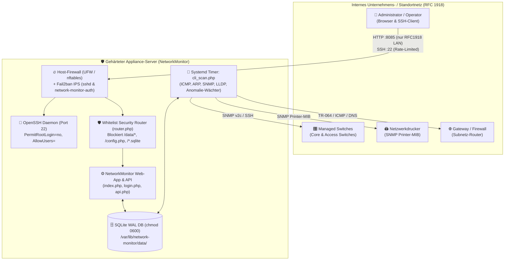

# 🛡️ IT-Sicherheitskonzept: NetworkMonitor (`v1.12.8`)

**Systembezeichnung:** NetworkMonitor – Automatischer Netzwerkplan, SNMP-Switch-Discovery & Anomalie-Wächter  
**Zielsystem (Appliance):** Dedizierter Linux-Appliance-Server (Debian/Ubuntu Server)  
**Dokumentenversion:** 1.0 (Passend zu Software-Release `v1.12.8`)  
**Klassifizierung:** Allgemeines Referenz-Sicherheitskonzept für Administratoren & IT-Sicherheitsbeauftragte  

---

## 1. Management Summary & Geltungsbereich

### 1.1 Zielsetzung des Sicherheitskonzepts
Dieses IT-Sicherheitskonzept beschreibt die technischen und organisatorischen Maßnahmen (TOM) zum sicheren Betrieb der Anwendung **NetworkMonitor** sowie des zugrunde liegenden Linux-Servers. Es orientiert sich an den Bausteinen des **BSI IT-Grundschutz-Kompendiums** (`SYS.1.3 Server unter Linux und Unix`, `APP.3.1 Webanwendungen`, `NET.1.2 Netzmanagement`) sowie der **ISO/IEC 27001**.

### 1.2 Abgrenzung des Informationsverbunds (Geltungsbereich)
Der betrachtete Informationsverbund umfasst:
1. **Hardware & Betriebssystem:** Dedizierter Linux-Server bzw. virtuelle Appliance unter Debian GNU/Linux oder Ubuntu LTS.
2. **Laufzeitumgebung & Systemdienste:**
   - Webserver-Dienst `network-monitor.service` (PHP CLI-Server im Multi-Worker-Betrieb mit vorgeschaltetem Whitelist-Security-Router [`router.php`](file:///home/uwe/Dokumente/Antigravity/NetworkMonitor/router.php)).
   - Hintergrund-Scanner `network-monitor-scan.service` & `network-monitor-scan.timer` (Systemd-Timer im 5-Minuten-Intervall).
   - Sicherheitsdienste: `ufw` / `nftables` (Host-Firewall), `fail2ban` (Intrusion Prevention), `openssh-server` (Fernwartung), `unattended-upgrades` (automatisches Patch-Management).
3. **Datenhaltung:** Lokale SQLite-Datenbank (`/var/lib/network-monitor/data/network_monitor.sqlite` im WAL-Modus) bzw. optional angebundene MySQL/MariaDB-Instanz sowie Konfigurationsdatei `/var/lib/network-monitor/data/custom_config.json`.
4. **Kommunikationsschnittstellen im LAN (RFC 1918):**
   - Eingehend: HTTP-Weboberfläche (`8085/tcp`), SSH-Administration (`22/tcp`).
   - Ausgehend: ICMP-Ping, ARP, DNS (`53/udp`), NetBIOS (`137/udp`), NSDP (`63322/udp`), SNMP v2c (`161/udp`), TR-064 (`49000/tcp`), SSH/Telnet für Switch-Port-Konfiguration (`22/tcp`, `23/tcp`), HTTPS für GitHub-Updates (`443/tcp`) und SMTP für Alarm-/2FA-E-Mails (`587/tcp`, `465/tcp`).



---

## 2. Schutzbedarfsfeststellung (CIA-Triade)

Da NetworkMonitor eine zentrale Übersicht über alle aktiven Systeme, Switch-Ports, VLANs sowie Zugangsdaten zur Switch-Administration verwaltet, ergibt sich folgender Schutzbedarf nach den Grundwerten **Vertraulichkeit (Confidentiality)**, **Integrität (Integrity)** und **Verfügbarkeit (Availability)**:

| Schutzobjekt / Asset | Vertraulichkeit | Integrität | Verfügbarkeit | Begründung |
| :--- | :---: | :---: | :---: | :--- |
| **Benutzerkonten, Passwort-Hashes & 2FA-Geheimnisse** (`users`-Tabelle) | **Hoch** | **Hoch** | Normal | Kompromittierung würde unbefugten Zugriff auf die Netzwerktopologie und Switch-Steuerung ermöglichen. |
| **Switch-SNMP-Communities & SSH/Telnet-Zugangsdaten** (`devices`-Tabelle) | **Hoch** | **Hoch** | Normal | Mit Schreibrechten (`netadmin`/`admin`) können Switch-Ports ein-/ausgeschaltet oder VLANs geändert werden. |
| **Datenbankdatei & Systemkonfiguration** (`network_monitor.sqlite`, `custom_config.json`) | **Hoch** | **Hoch** | Normal | Enthält sämtliche Inventar-, Topologie-, Benutzer- und SMTP-Zugangsdaten. Direkter Download über Webserver muss technisch ausgeschlossen sein. |
| **Topologie-, MAC-Historien- & Dosen-Patchdaten** (`devices`, `links`, `mac_port_history`, `switch_port_outlets`) | **Mittel (Intern)** | **Hoch** | Normal | Falsche Port-/Dosen-Zuordnungen oder manipulierte Anomalie-Alarme führen zu Fehlentscheidungen im Netzbetrieb. |
| **Verfügbarkeit des Monitoring-Dienstes** (`network-monitor.service` & Scanner-Timer) | Niedrig | Normal | **Mittel** | Ein kurzer Ausfall beeinträchtigt nicht den produktiven Netzwerkverkehr (Out-of-Band Monitoring), verzögert jedoch Offline-/Sicherheits-Alarme. |

---

## 3. Bedrohungs- und Risikoanalyse

| ID | Bedrohungsszenario | Angriffsvektor | Technische Gegenmaßnahme in NetworkMonitor `v1.12.8` | Restrisiko |
| :--- | :--- | :--- | :--- | :---: |
| **T-01** | **Unbefugter Download der SQLite-Datenbank über HTTP** | Direkter Abruf von `/data/network_monitor.sqlite` oder `/config.php` beim PHP Built-in Server (`php -S`), da dieser `.htaccess` ignoriert. | Strikter Whitelist-Router ([`router.php`](file:///home/uwe/Dokumente/Antigravity/NetworkMonitor/router.php)) auf Webserver-Ebene + [`.htaccess`](file:///home/uwe/Dokumente/Antigravity/NetworkMonitor/.htaccess) für Apache. Jeder Zugriff außerhalb der 4 freigegebenen PHP-Skripte und `/assets/` wird sofort mit `HTTP 403 Forbidden` blockiert. | Sehr gering |
| **T-02** | **Brute-Force-Angriff auf Web-Login oder SSH** | Automatisiertes Durchprobieren von Passwörtern gegen `login.php` (`8085/tcp`) oder `sshd` (`22/tcp`). | Dreistufiger Schutz:<br>1. App-internes Session- & IP-Rate-Limiting ([`Auth::checkRateLimit()`](file:///home/uwe/Dokumente/Antigravity/NetworkMonitor/includes/auth.php#L67-L87), Sperre nach 6 Fehlversuchen).<br>2. Syslog-Protokollierung + **Fail2ban-Jails** (`network-monitor-auth` & `sshd`) mit 1 Stunde IP-Sperre.<br>3. UFW Connection-Rate-Limiting auf Port `22/tcp`. | Sehr gering |
| **T-03** | **SQL-Injection (SQLi) & Cross-Site-Scripting (XSS)** | Manipulierte Eingaben in Suchfeldern, SNMP-Gerätenamen (z.B. manipulierte `sysName`-Strings) oder API-Parametern. | 100 % Einsatz von **PDO Prepared Statements** (`ATTR_EMULATE_PREPARES = false`) in [`api.php`](file:///home/uwe/Dokumente/Antigravity/NetworkMonitor/api.php) und [`includes/scanner.php`](file:///home/uwe/Dokumente/Antigravity/NetworkMonitor/includes/scanner.php). Konsequentes HTML-Escaping (`escapeHtml()` / `htmlspecialchars()`) im Frontend ([`assets/app.js`](file:///home/uwe/Dokumente/Antigravity/NetworkMonitor/assets/app.js)). | Sehr gering |
| **T-04** | **Session Hijacking & Session Fixation** | Auslesen der Session-ID per XSS oder Unterschieben einer bekannten Session-ID vor dem Login. | `session.cookie_httponly = 1`, `session.cookie_samesite = Lax`, `session.use_strict_mode = 1` sowie zwingendes `session_regenerate_id(true)` nach erfolgreichem Login ([`Auth::completeLoginSession()`](file:///home/uwe/Dokumente/Antigravity/NetworkMonitor/includes/auth.php#L271-L286)). | Gering |
| **T-05** | **Unbefugte Manipulation von Core-Switches durch Standard-Bediener** | Ein Operator oder Gast versucht, Core-Switches einzusehen oder Trunk-/Uplink-Ports umzukonfigurieren. | Strikte serverseitige Rollentrennung (RBAC): Core-Switches (`is_core = 1`) werden für `viewer` und `operator` bereits in [`api.php`](file:///home/uwe/Dokumente/Antigravity/NetworkMonitor/api.php) auf Datenbankebene herausgefiltert; Switch-Credentials und Trunk-Ports erfordern zwingend die Rolle `netadmin` oder `admin`. | Sehr gering |
| **T-06** | **Netzwerk-Angriffe im überwachten LAN** (ARP-Spoofing, Rogue-Switches, MAC-Flapping) | Angreifer hängt eigenen Mini-Switch an eine Bürodose oder führt ARP-Poisoning im Subnetz durch. | Integrierter **Anomalie-Wächter** in [`NetworkScanner::processNetworkAnomalies()`](file:///home/uwe/Dokumente/Antigravity/NetworkMonitor/includes/scanner.php#L1990-L2147) erkennt ARP-Konflikte, unbekannte MACs, Multi-MACs an Access-Ports, MAC-Flapping und Port-Fehler automatisch. | Gering |

---

## 4. Technische Härtungsmaßnahmen (Server & Betriebssystem)

Für den produktiven Betrieb als Linux-Appliance sind folgende Härtungsmaßnahmen vorgesehen:

### 4.1 Host-Firewall (`ufw` / `nftables`)
Die Firewall verfolgt eine strikte **Default-Deny-Strategie** für eingehenden Datenverkehr (`Default: deny (incoming), allow (outgoing)`):

| Regel-Nr. | Port / Protokoll | Aktion | Erlaubte Quellnetze | Zweck |
| :---: | :--- | :---: | :--- | :--- |
| **1 / 6** | `22/tcp` (IPv4 & IPv6) | `LIMIT IN` | Alle (mit Rate-Limit: max. 6 Verbindungen / 30 s) | Abgesicherter SSH-Fernwartungszugang |
| **2 – 4** | `8085/tcp` (IPv4) | `ALLOW IN` | `192.168.0.0/16`, `10.0.0.0/8`, `172.16.0.0/12` | Zugriff auf NetworkMonitor Web-UI nur aus internen RFC1918-Netzen |
| **7 – 8** | `8085/tcp` (IPv6) | `ALLOW IN` | `fd00::/8` (ULA), `fe80::/10` (Link-Local) | Zugriff auf NetworkMonitor Web-UI über internes IPv6 |
| **5** | `5353/udp` (IPv4) | `ALLOW IN` | Lokales Subnetz (RFC 1918) | Lokale mDNS-Namensauflösung |

### 4.2 SSH-Härtung (`/etc/ssh/sshd_config.d/99-security-hardening.conf`)
- **Kein direkter Root-Login:** `PermitRootLogin no`
- **Explizite Benutzer-Whitelist:** `AllowUsers <admin-user>` (Beschränkung auf das dedizierte Administrationskonto)
- **Reduzierte Anmeldeversuche & Timeout:** `MaxAuthTries 3`, `LoginGraceTime 30`, `PermitEmptyPasswords no`
- **Deaktivierte Weiterleitungen:** `X11Forwarding no`, `AllowTcpForwarding no`, `AllowAgentForwarding no`, `PermitUserEnvironment no`
- **Idle-Session-Trennung:** `ClientAliveInterval 300`, `ClientAliveCountMax 2` (trennt verwaiste Sitzungen nach 10 Minuten Inaktivität)

### 4.3 Intrusion Prevention System (`fail2ban`)
Konfiguriert in `/etc/fail2ban/jail.d/99-network-monitor.local` mit Systemd-Journal-Backend:
1. **Jail `sshd`:** Überwacht Port `22/tcp`, sperrt IP-Adressen nach `5` Fehlversuchen innerhalb von `10 Minuten` für `1 Stunde`.
2. **Jail `network-monitor-auth`:** Nutzt den Filter `/etc/fail2ban/filter.d/network-monitor-auth.conf`, wertet die Syslog-Meldungen aus [`Auth::recordFailedAttempt()`](file:///home/uwe/Dokumente/Antigravity/NetworkMonitor/includes/auth.php#L94-L141) (`NetworkMonitor: Failed authentication attempt from <HOST>`) aus und sperrt Angreifer-IPs nach `6` fehlgeschlagenen Web-Logins auf Firewall-Ebene für Port `8085/tcp`.

### 4.4 Kernel- & Netzwerk-Stack-Härtung (`/etc/sysctl.d/99-security-hardening.conf`)
- **Anti-DoS & Anti-Spoofing:** `net.ipv4.tcp_syncookies = 1`, `net.ipv4.conf.all.rp_filter = 1`, `net.ipv4.icmp_echo_ignore_broadcasts = 1`.
- **MITM-Schutz gegen geroutete/umgeleitete Pakete:** `accept_redirects = 0`, `secure_redirects = 0`, `send_redirects = 0`, `accept_source_route = 0` (für IPv4 und IPv6).
- **Kernel- & Dateisystem-Schutz:** `kernel.kptr_restrict = 2`, `kernel.dmesg_restrict = 1`, `fs.protected_hardlinks = 1`, `fs.protected_symlinks = 1`, `fs.protected_fifos = 2`, `fs.protected_regular = 2`.

### 4.5 Systemd-Sandboxing & Dateisystemberechtigungen
- **Dateirechte:**
  - `/opt/network-monitor`: `0750` (`root:root`), Programmdateien `0640` (`cli_scan.php` `0750`).
  - `/var/lib/network-monitor/data`: `0700` (`root:root`), Datenbank `network_monitor.sqlite` und `custom_config.json` strikt `0600` (nur für den Dienstprozess les-/schreibbar).
- **Systemd-Service-Isolation (`network-monitor.service` & `network-monitor-scan.service`):**
  - `PrivateTmp=true` (isoliertes `/tmp`-Verzeichnis)
  - `ProtectControlGroups=true`, `ProtectKernelModules=true`, `ProtectKernelTunables=true`
  - `RestrictSUIDSGID=true`, `UMask=0027`
- **Minimierung der Angriffsfläche:** Nicht benötigte Systemdienste wie der Druckserver `cups.service` (`631/tcp`) wurden dauerhaft gestoppt und deaktiviert.
- **Automatisches Patch-Management:** Über `unattended-upgrades` (`/etc/apt/apt.conf.d/20auto-upgrades`) werden Debian-Sicherheitsupdates täglich vollautomatisch eingespielt.

---

## 5. Anwendungssicherheit & Rollen-/Berechtigungskonzept (RBAC)

### 5.1 Authentifizierung, Passwortsicherheit & Zwei-Faktor-Authentifizierung (2FA)
- **Passwort-Speicherung:** Passwörter werden ausschließlich mittels `password_hash(..., PASSWORD_DEFAULT)` (Bcrypt mit individuellem kryptographischem Salt) in der Spalte `users.password_hash` gespeichert ([`includes/auth.php`](file:///home/uwe/Dokumente/Antigravity/NetworkMonitor/includes/auth.php)). Klartext-Passwörter werden niemals gespeichert oder geloggt.
- **Zwei-Faktor-Authentifizierung (2FA):** Jedes Benutzerkonto unterstützt wahlweise:
  - **TOTP (RFC 6238 / Google & Microsoft Authenticator, KeePassXC, Bitwarden):** 6-stellige zeitbasierte Einmalcodes über 160-Bit Base32-Secret ([`Auth::verifyTotpCode()`](file:///home/uwe/Dokumente/Antigravity/NetworkMonitor/includes/auth.php#L476-L515)).
  - **E-Mail-OTP:** 6-stelliger kryptographischer Zufallscode (`random_int`), der gehasht in der Datenbank abgelegt wird und nach 10 Minuten verfällt.
- **Erstinbetriebnahme-Schutz:** Bei einer Neuinstallation existiert ausschließlich das Konto `admin` (keine versteckten Test- oder Operator-Konten).

### 5.2 Vierstufiges Rollen- und Berechtigungskonzept (RBAC)
Jeder API-Aufruf in [`api.php`](file:///home/uwe/Dokumente/Antigravity/NetworkMonitor/api.php) prüft serverseitig über [`Auth::requireRole()`](file:///home/uwe/Dokumente/Antigravity/NetworkMonitor/includes/auth.php#L569-L598) die Rolle des angemeldeten Benutzers:

| Funktion / Berechtigung | `viewer` (Nur Lesen) | `operator` (Techniker) | `netadmin` (Netzwerkexperte) | `admin` (Administrator) |
| :--- | :---: | :---: | :---: | :---: |
| Topologie, Inventarliste & Dosen-Finder ansehen (ohne Core-Switches) | ✅ | ✅ | ✅ | ✅ |
| Eigenes Passwort & eigene 2FA-Methode verwalten | ✅ | ✅ | ✅ | ✅ |
| Netzwerk-Scan starten & Einzelgerät per SNMP abfragen | ❌ | ✅ | ✅ | ✅ |
| Geräte-Alarme & Sicherheits-Ereignisse quittieren / kommentieren | ❌ | ✅ | ✅ | ✅ |
| Standard-Geräte, Gruppen, Dosen-Patchplan & Access-Switch-Ports pflegen | ❌ | ✅ | ✅ | ✅ |
| **Core-Switches (`is_core = 1`)** auf Karte & in Inventarliste sehen | ❌ *(Gefiltert)* | ❌ *(Gefiltert)* | ✅ | ✅ |
| **Trunk-/Uplink-Ports** umschalten & Switch-SSH/SNMP-Zugangsdaten pflegen | ❌ | ❌ | ✅ | ✅ |
| IP-Scopes (VLANs/Subnetze) anlegen, bearbeiten & löschen | ❌ | ✅ | ✅ | ✅ |
| Benutzerverwaltung, Datenbank-, Scanner-, Anomalie-, SMTP- & GitHub-Update-Steuerung | ❌ | ❌ | ❌ | ✅ |

---

## 6. Datensicherungs-, Aufbewahrungs- & Notfallkonzept

1. **Automatische Datenbereinigung (Retention-Policy / Datensparsamkeit):**
   - Über [`NetworkScanner::cleanupOldScans()`](file:///home/uwe/Dokumente/Antigravity/NetworkMonitor/includes/scanner.php#L2766-L2825) werden alte Scan-Protokolle (`scan_logs`) und quittierte Alarme (`device_alerts`) nach der konfigurierten Aufbewahrungsfrist (Standard: **14 Tage**) sowie dauerhaft verwaiste Offline-Geräte (Standard: **30 Tage**) automatisch bereinigt.
2. **Backup der Anwendungsdaten:**
   - Sämtliche persistenten Daten liegen zentral unter `/var/lib/network-monitor/data/` (`network_monitor.sqlite` und `custom_config.json`).
   - Zur konsistenten Sicherung im laufenden Betrieb genügt ein täglicher Snapshot:
     ```bash
     sqlite3 /var/lib/network-monitor/data/network_monitor.sqlite ".backup '/var/backups/network_monitor_$(date +%F).sqlite'"
     chmod 0600 /var/backups/network_monitor_*.sqlite
     ```
3. **Wiederanlauf (Disaster Recovery):**
   - Neuinstallation über das Debian-Paket `dpkg -i network-monitor_1.12.8_all.deb` dauert **< 10 Sekunden**.
   - Nach Zurückspielen von `/var/lib/network-monitor/data/network_monitor.sqlite` und `custom_config.json` sowie `systemctl restart network-monitor` ist der vollständige Systemzustand inklusive aller manuell gepflegten Dosen-Beschriftungen, Gruppen und Knoten-Positionen sofort wiederhergestellt.
