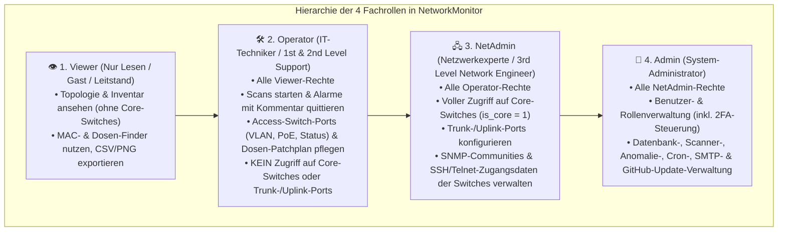
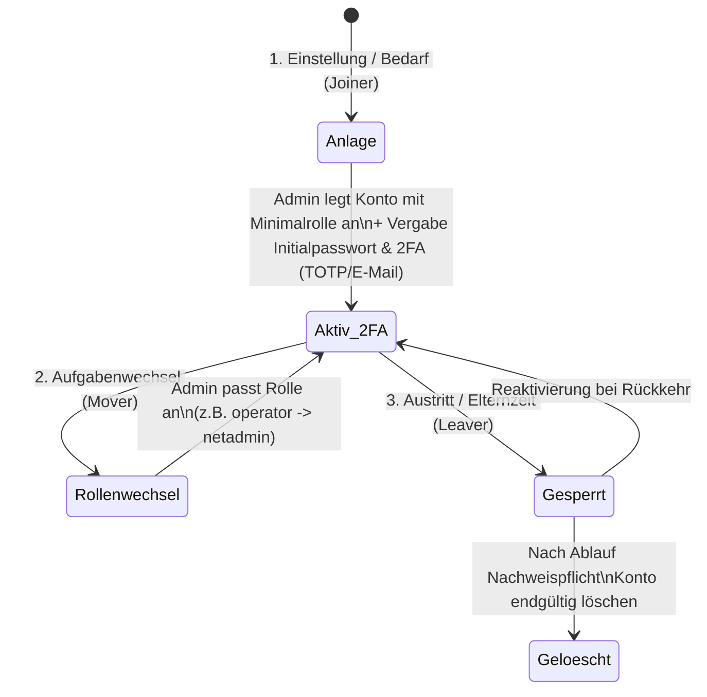

# 🔐 Rollen- und Berechtigungskonzept (RBAC): NetworkMonitor (`v1.12.8`)

**Systembezeichnung:** NetworkMonitor – Automatischer Netzwerkplan, SNMP-Switch-Discovery & Anomalie-Wächter  
**Dokumententyp:** Identitäts-, Rollen- und Berechtigungskonzept (orientiert an **BSI IT-Grundschutz ORP.4** *Identitäts- und Berechtigungsmanagement*)  
**Software-Version:** `v1.12.8`  
**Klassifizierung:** Allgemeines Referenzkonzept (frei von personen- oder standortbezogenen Geheimnissen)  

---

## 1. Zielsetzung & Grundprinzipien

Das Rollen- und Berechtigungskonzept regelt verbindlich, welche Benutzergruppen innerhalb von **NetworkMonitor** auf welche Netzwerkdaten lesend oder schreibend zugreifen und welche aktiven Steuerungsfunktionen (z. B. Switch-Port-Konfiguration, Benutzerverwaltung, System-Updates) sie ausführen dürfen.

Es basiert auf vier Sicherheitsprinzipien:
1. **Minimalprinzip (*Least Privilege*):** Jeder Benutzer erhält ausschließlich die Berechtigungen, die er für seine unmittelbare betriebliche Aufgabe benötigt.
2. **Kenntnisnahme nur bei Bedarf (*Need-to-Know*):** Kritische Backbone-Komponenten (**Core-Switches**, `is_core = 1`) sowie hinterlegte SNMP-/SSH-Zugangsdaten sind für Standard-Anwender (`viewer`) und Techniker (`operator`) technisch unsichtbar.
3. **Funktionstrennung (*Segregation of Duties*):**
   - **Tagesbetrieb & Entstörung** (`operator`: Endgeräte, Netzwerkdosen, Access-Ports, Alarm-Quittierung),
   - **Netzwerk-Architektur & Core-Infrastruktur** (`netadmin`: Core-Switches, Trunk-/Uplink-Ports, Switch-Credentials),
   - **System- & Benutzeradministration** (`admin`: Konten, Rollenvergabe, Datenbank, SMTP, System-Updates).
4. **Serverseitige Durchsetzung (*Zero-Trust gegenüber dem Client*):** Das Ausblenden von Schaltflächen im Browser dient nur der Bedienbarkeit. Jede einzelne Aktion wird im Backend ([`api.php`](file:///home/uwe/Dokumente/Antigravity/NetworkMonitor/api.php)) über [`Auth::requireRole()`](file:///home/uwe/Dokumente/Antigravity/NetworkMonitor/includes/auth.php#L569-L598) anhand der serverseitigen PHP-Session validiert.

---

## 2. Definition der Rollenprofile

### 2.1 Rolle `viewer` (Nur Lesen / Gast / Leitstand)
- **Zielgruppe:** Helpdesk-Mitarbeiter (1st Level), Auszubildende, Management, Monitoring-Bildschirme im Leitstand.
- **Erlaubte Funktionen:**
  - Interaktive Topologie-Karte, Hierarchie-, Matrix- und 19"-Switch-Ansicht betrachten (nur Access-/Distribution-Ebene).
  - Geräte-Inventarliste filtern, sortieren und als CSV exportieren.
  - MAC-, Dosen- und Switch-Port-Finder nutzen (*„Auf welchem Port liegt Dose 1.12?“*).
  - Eigenes Passwort ändern und eigene Zwei-Faktor-Authentifizierung (TOTP / E-Mail) im Dialog *„Mein Konto“* verwalten.
- **Technische Einschränkungen:**
  - Keinerlei Schreibzugriff auf Geräte, Dosen, Alarme oder Scopes.
  - Core-Switches (`is_core = 1`) sowie deren Verbindungen werden bereits vor der Auslieferung durch [`api.php`](file:///home/uwe/Dokumente/Antigravity/NetworkMonitor/api.php#L78-L98) aus dem JSON-Datenstrom entfernt.

### 2.2 Rolle `operator` (Techniker / Vor-Ort-Service)
- **Zielgruppe:** IT-Systemelektroniker, Rollout-Techniker, Haus-IT, 2nd-Level-Support.
- **Erlaubte Funktionen (zusätzlich zu `viewer`):**
  - Manuelle Netzwerk-Scans (`scan`) sowie SNMP-Einzelabfragen (`probe_device_snmp`, z. B. für Drucker-Tintenfüllstände) anstoßen.
  - Geräte- und Sicherheitsalarme einzeln, mehrfach per Checkbox oder gesammelt mit Techniker-Kommentar quittieren (`ack_alerts`).
  - Gerätenamen, Gerätetypen, Gruppen, Standortnotizen, Alarm-Modi und Knoten-Positionen auf der Karte speichern.
  - Netzwerkdosen- und Patchfeld-Zuordnungen (`switch_port_outlets`) einzeln oder per Massenimport pflegen.
  - **Access-Switch-Ports** auf Nicht-Core-Switches verwalten (Port Ein/Aus, Port-Bezeichnung/Alias, Access-VLAN PVID, PoE Auto/Aus).
- **Technische Schutzschranken (Safety-Guardrails):**
  - **Kein Zugriff auf Core-Switches:** Geräte mit `is_core = 1` sind weder sichtbar noch über ihre `device_id` abrufbar oder änderbar.
  - **Trunk- & Uplink-Sperre:** Versucht ein `operator`, einen Switch-Port zu ändern, der als Uplink/Trunk erkannt wurde oder im Trunk-Modus läuft, verweigert [`api.php`](file:///home/uwe/Dokumente/Antigravity/NetworkMonitor/api.php#L635-L670) den Vorgang serverseitig, damit ein Techniker niemals versehentlich einen ganzen Etagen-Switch vom Netz trennen kann.

### 2.3 Rolle `netadmin` (Netzwerkexperte / Network Engineer)
- **Zielgruppe:** Netzwerk-Architekten, Senior Network Engineers (3rd Level).
- **Erlaubte Funktionen (zusätzlich zu `operator`):**
  - Volle Sichtbarkeit und Verwaltung aller **Core-Switches (`is_core = 1`)** sowie Setzen/Entfernen des Core-Switch-Flags.
  - Konfiguration von **Trunk-, Uplink- und Kaskaden-Ports** (`port_mode = trunk`, `allowed_vlans`).
  - Hinterlegen und Ändern der **Switch-Zugangsdaten** (`save_switch_credentials`: abweichende SNMP-Write-Community, SSH/Telnet-Benutzer, Passwort, Enable-Secret, Hersteller-Profil).
- **Technische Abgrenzung zu `admin`:**
  - Ein `netadmin` hat **keinen** Zugriff auf die Benutzerverwaltung (`users`), Datenbank-Verbindungsparameter, SMTP-Server-Zugangsdaten oder das Einspielen von System-Updates.

### 2.4 Rolle `admin` (System-Administrator)
- **Zielgruppe:** Systemverantwortliche / Hauptadministratoren der NetworkMonitor-Appliance.
- **Erlaubte Funktionen (Vollzugriff):**
  - Beinhaltet sämtliche Rechte von `netadmin`.
  - **Benutzer- & Rollenverwaltung (`save_user`, `delete_user`):** Anlegen, Bearbeiten, Sperren und Löschen von Benutzern sowie Konfiguration der 2FA-Pflicht (`none`, `email`, `totp`).
  - **System- & Datenbankkonfiguration (`save_db_config`, `test_db`):** Umschaltung zwischen SQLite und MySQL/MariaDB, Feintuning der Scan-Timeouts und Batch-Größen.
  - **Anomalie-Wächter & Retention (`admin_save_anomaly_config`, `admin_save_cron_retention`):** Festlegen der Schwellenwerte für ARP-Spoofing, Rogue-Switches, MAC-Flapping und Port-Fehler sowie der Aufbewahrungsfristen.
  - **SMTP-Konfiguration & GitHub-Live-Updater (`save_smtp_config`, `admin_run_update`):** E-Mail-Benachrichtigungen und Einspielen signierter Updates von GitHub.

---

## 3. Vollständige Berechtigungsmatrix (Fachfunktionen & API-Endpunkte)

Die folgende Matrix dokumentiert die exakte serverseitige Berechtigungsprüfung in [`api.php`](file:///home/uwe/Dokumente/Antigravity/NetworkMonitor/api.php):

| Modul / Fachfunktion | Technischer API-Endpunkt (`api.php?action=...`) | `viewer` | `operator` | `netadmin` | `admin` | Besonderheiten / Sicherheitsfilter |
| :--- | :--- | :---: | :---: | :---: | :---: | :--- |
| **Topologie & Inventar laden** | `topology` | ✅ | ✅ | ✅ | ✅ | Für `viewer` & `operator` werden Core-Switches (`is_core=1`) und Switch-Passwörter serverseitig ausgefiltert; `admin`-Sektion nur für `admin`. |
| **Eigenes Passwort & 2FA ändern** | `change_own_password`, `generate_totp_secret` | ✅ | ✅ | ✅ | ✅ | Erfordert Eingabe des bisherigen eigenen Passworts zur Verifikation. |
| **Netzwerk-Scan ausführen** | `scan` | ❌ | ✅ | ✅ | ✅ | Session-Lock wird vor Scan-Start via [`Auth::closeSession()`](file:///home/uwe/Dokumente/Antigravity/NetworkMonitor/includes/auth.php#L46-L53) freigegeben. |
| **Einzelgerät per SNMP abfragen** | `probe_device_snmp` | ❌ | ✅ | ✅ | ✅ | Liest u. a. Drucker-Tintenfüllstände und Switch-Ports live aus. |
| **Alarme quittieren / kommentieren** | `ack_alerts`, `clear_alerts` | ❌ | ✅ | ✅ | ✅ | Speichert Benutzername (`ack_by`), Zeitstempel (`ack_at`) und Kommentar (`ack_comment`). |
| **Geräte-Eigenschaften speichern** | `save_device`, `delete_device` | ❌ | ✅* | ✅ | ✅ | *`operator` darf keine Core-Switches bearbeiten/löschen und das Flag `is_core` nicht setzen. |
| **Karten-Sichtbarkeit & Layout** | `toggle_device_visibility`, `bulk_device_visibility`, `toggle_group_visibility`, `save_layout_positions`, `reset_layout_positions` | ❌ | ✅ | ✅ | ✅ | Steuert Ein-/Ausblendung und feste `(pos_x, pos_y)`-Koordinaten im Netzwerkplan. |
| **Netzwerkdosen & Patchplan** | `save_port_outlet`, `save_port_outlets_bulk` | ❌ | ✅* | ✅ | ✅ | *`operator` nur für Nicht-Core-Switches. |
| **MAC-Watchlist verwalten** | `save_mac_watchlist`, `delete_mac_watchlist` | ❌ | ✅ | ✅ | ✅ | Überwachungsliste für gesuchte oder verdächtige MAC-Adressen. |
| **IP-Scopes (VLANs/Subnetze)** | `save_scope`, `delete_scope`, `seed_demo` | ❌ | ✅ | ✅ | ✅ | Validiert CIDR-Präfixe (`/16` bis `/30`). |
| **Switch-Port aktiv umstellen** | `configure_switch_port` | ❌ | ✅* | ✅ | ✅ | *`operator` nur für Access-Ports auf Nicht-Core-Switches; **Trunk-/Uplink-Ports erfordern `netadmin` oder `admin`**. |
| **Switch SSH/SNMP-Zugangsdaten** | `save_switch_credentials` | ❌ | ❌ | ✅ | ✅ | Speichert SSH/Telnet-Login, Enable-Passwort und SNMP-Write-Community des Switches. |
| **Anomalie-Wächter Schwellenwerte** | `admin_save_anomaly_config` | ❌ | ❌ | ❌ | ✅ | Konfiguriert ARP-Spoofing-, Rogue-Switch-, MAC-Flapping- und Port-Fehler-Grenzen. |
| **Datenbank, Scanner & Cronjob** | `test_db`, `save_db_config`, `admin_save_cron_retention`, `admin_run_retention_cleanup` | ❌ | ❌ | ❌ | ✅ | Verwaltung von SQLite/MySQL, Scan-Timeouts und Aufbewahrungsfristen. |
| **SMTP & E-Mail-Alarme** | `save_smtp_config`, `test_smtp` | ❌ | ❌ | ❌ | ✅ | SMTP-Zugangsdaten für Alarm-Mails und E-Mail-2FA. |
| **GitHub Live-Update & Reset** | `admin_check_update`, `admin_run_update`, `admin_clear_scope_scans`, `admin_delete_all_scopes`, `admin_clear_scan_logs` | ❌ | ❌ | ❌ | ✅ | System-Updates und Datenbank-Zurücksetzung. |
| **Benutzer- & Rollenverwaltung** | `save_user`, `delete_user` | ❌ | ❌ | ❌ | ✅ | Inkl. Selbstschutz: Ein `admin` kann sein eigenes aktives Konto weder löschen noch herabstufen. |

---

## 4. Technische Schutzmechanismen im Berechtigungsmanagement

### 4.1 Zweistufige Isolation von Core-Switches (`is_core = 1`)
Um das Rückgrat des Netzwerks (Core-/Backbone-Switches) vor Fehlbedienung zu schützen, greift eine doppelte Sperre:
1. **Lesefilter in [`api.php` (`case 'topology'`)](file:///home/uwe/Dokumente/Antigravity/NetworkMonitor/api.php#L78-L98):**
   Ist der angemeldete Benutzer weder `netadmin` noch `admin` (`!$isNetExpert`), entfernt der Server vor dem Senden der JSON-Antwort alle Geräte mit `is_core == 1` sowie sämtliche Topologie-Links (`links`), die auf einen Core-Switch zeigen.
2. **Schreibsperre in [`api.php` (`save_device`, `delete_device`, `configure_switch_port`)](file:///home/uwe/Dokumente/Antigravity/NetworkMonitor/api.php#L415-L670):**
   Selbst bei manipulierten HTTP-POST-Anfragen prüft der Server vor jeder Änderung in der Datenbank `SELECT is_core FROM devices WHERE id = :id`. Ist `is_core == 1` und der Benutzer kein `netadmin`/`admin`, bricht der Aufruf mit einer Fehlermeldung (`HTTP 400`) ab.

### 4.2 Schutz von Switch-Zugangsdaten im Frontend-Datenstrom
In der Tabelle `devices` gespeicherte Switch-Passwörter (`switch_pass`, `switch_enable_pass`) werden bei `api.php?action=topology` **niemals im Klartext** an den Browser übertragen ([`api.php`](file:///home/uwe/Dokumente/Antigravity/NetworkMonitor/api.php#L86-L97)). Stattdessen setzt das Backend lediglich boolesche Statusfelder (`has_switch_pass = 1`, `has_switch_enable = 1`) und löscht die Passwortfelder (`unset($d['switch_pass'], $d['switch_enable_pass'])`) vor dem `json_encode()`.

### 4.3 Schutz vor Admin-Aussperrung (Anti-Lockout-Regel)
In [`api.php` (`save_user` & `delete_user`)](file:///home/uwe/Dokumente/Antigravity/NetworkMonitor/api.php#L1278-L1343) verhindert eine verbindliche Prüfung, dass ein angemeldetes Administratorkonto sich versehentlich selbst löscht (`$uid === (int)$currentUser['id']`), deaktiviert (`is_active = 0`) oder seine eigene Rolle auf `viewer`/`operator`/`netadmin` herabstuft. Damit ist sichergestellt, dass stets mindestens ein handlungsfähiger `admin` im System verbleibt.

---

## 5. Organisatorische Prozesse (Benutzer-Lebenszyklus)

1. **Neuanlage (*Joiner*):**
   - Neue Benutzer werden durch einen `admin` unter **Administration -> Benutzer- & Rollenverwaltung** grundsätzlich zunächst mit der niedrigsten erforderlichen Rolle (`viewer` oder `operator`) angelegt.
   - Für Konten mit den Rollen `netadmin` und `admin` wird die Aktivierung der **Zwei-Faktor-Authentifizierung (`totp` per Authenticator-App oder `email`)** dringend empfohlen.
2. **Aufgabenwechsel (*Mover*):**
   - Wechselt ein Mitarbeiter das Aufgabengebiet, passt der `admin` die Rolle in der Benutzerverwaltung an. Die neue Rolle greift sofort beim nächsten Seiten- oder API-Aufruf, da [`Auth::getCurrentUser()`](file:///home/uwe/Dokumente/Antigravity/NetworkMonitor/includes/auth.php#L148-L175) Rolle und Aktivstatus bei jedem Request live gegen die Datenbank prüft.
3. **Austritt / Sperrung (*Leaver*):**
   - Scheidet ein Mitarbeiter aus, setzt der Administrator das Konto sofort auf **Inaktiv (`is_active = 0`)** oder löscht es.
   - Da [`Auth::getCurrentUser()`](file:///home/uwe/Dokumente/Antigravity/NetworkMonitor/includes/auth.php#L165-L171) bei jedem Aufruf `WHERE id = :id AND is_active = 1` prüft, werden auch noch offene Browser-Sitzungen eines gesperrten Benutzers **sofort im selben Moment ungültig** (`Auth::logout()`).
